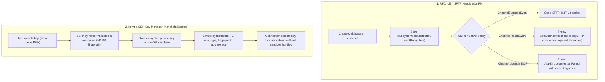

# Implementation Plan: OpenSSH Handshake Protocol Fix & In-App SSH Key Management

## Goal Description
Resolve connection failures (`NIOCore.ChannelError error 9` / `ChannelError.eof`) when connecting to modern OpenSSH servers (OpenSSH 9.8p1+ / 10.x) by synchronizing the SFTP subsystem channel handshake per RFC 4254, while preserving 100% backward compatibility with older OpenSSH servers. Additionally, introduce an **In-App SSH Key Manager** backed by macOS Keychain so users can import and manage SSH keys directly within MacSCP, eliminating macOS App Sandbox file permission failures and stale bookmark issues forever.

## User Review Required
> [!IMPORTANT]
> **OpenSSH Server Compatibility Guarantee**: The handshake fix strictly adheres to RFC 4254 (waiting for `SSH_MSG_CHANNEL_SUCCESS` before sending `SSH_FXP_INIT`). This is backward-compatible with older OpenSSH servers (e.g. OpenSSH 6.x/7.x/8.x on Ubuntu 16/18/20/22, CentOS 7/8, Debian, Alpine) as well as the latest OpenSSH 10.x.

> [!TIP]
> **SSH Key Security in macOS Sandbox**: Instead of holding fragile file path references to `~/.ssh/` that require security-scoped bookmarks (which frequently break after macOS updates or file moves), keys imported into the app will be encrypted and stored in **macOS Keychain** using Apple's Security framework. The private keys remain hardware-backed/secure while being 100% immune to sandbox permission rejections. Existing connections using file paths will continue to be supported seamlessly.

## Open Questions
None. The requirements are clear: fix the OpenSSH race condition handshake, ensure full backward compatibility, and implement in-app SSH key storage to protect against sandbox issues.

---

## Proposed Changes



---

### Component 1: SFTP Subsystem Handshake Synchronization

#### [MODIFY] `macSCP/Data/SFTP/Engine/SFTPChannelHandler.swift`
- Add support for `userInboundEventTriggered` to intercept:
  - `ChannelSuccessEvent`: Server accepted the SFTP subsystem request. Signal success to the connection promise.
  - `ChannelFailureEvent`: Server rejected the SFTP subsystem. Signal failure with an informative error.
- Notify delegate or connection coordinator when the subsystem is ready to receive packets.

#### [MODIFY] `macSCP/Data/SFTP/Engine/SSHConnection.swift`
- In `connect(...)`, replace fire-and-forget `triggerUserOutboundEvent(subsystemRequest)` with an asynchronous wait for `subsystemReadyPromise`.
- Only trigger `client.initialize()` AFTER the subsystem channel has confirmed success.
- If the server rejects the subsystem, fail fast with: `"SFTP subsystem was rejected by the server. Please verify that 'Subsystem sftp' is enabled in /etc/ssh/sshd_config."`

#### [MODIFY] `macSCP/Data/SFTP/SFTPSession.swift`
- Update `parseError(_:)` to catch `NIOCore.ChannelError`:
  - When encountering `ChannelError.eof` or `ioOnClosedChannel`, output user-friendly diagnostic messages instead of the raw `(NIOCore.ChannelError error 9.)`.

---

### Component 2: In-App SSH Key Manager (Keychain-Backed)

#### [NEW] `macSCP/Domain/Models/SSHKeyItem.swift`
- Domain model representing an imported SSH key:
  - `id: UUID`
  - `name: String` (e.g. "Production Server", "id_ed25519")
  - `keyType: String` ("Ed25519", "RSA", "ECDSA")
  - `fingerprint: String` (SHA256 fingerprint)
  - `publicKeyString: String?` (OpenSSH public key representation for convenience/export)
  - `createdAt: Date`

#### [NEW] `macSCP/Domain/RepositoryProtocols/SSHKeyRepositoryProtocol.swift`
- Protocol declaring key management operations:
  - `saveKey(item: SSHKeyItem, privateKeyContent: String) throws`
  - `getPrivateKey(keyId: UUID) throws -> String?`
  - `getAllKeys() -> [SSHKeyItem]`
  - `deleteKey(keyId: UUID) throws`

#### [NEW] `macSCP/Data/Keychain/SSHKeyStorageService.swift`
- Concrete implementation conforming to `SSHKeyRepositoryProtocol`:
  - Uses `kSecClassGenericPassword` with service `com.macSCP.sshKeys` to store private key contents encrypted in the macOS Keychain.
  - Stores metadata list in `UserDefaults` or Application Support.
  - Methods to parse and validate key content before saving using `SSHKeyParser`.

#### [MODIFY] `macSCP/Domain/Models/Connection.swift`
- Add optional `sshKeyId: UUID?` to `Connection` to link directly to an in-app stored key.
- Backward compatibility: If `sshKeyId` is set, load key from `SSHKeyStorageService`; otherwise, fall back to existing `privateKeyPath` and `securityScopedBookmarkData`.

#### [MODIFY] `macSCP/Data/SFTP/SFTPSession.swift`
- Support connecting with `privateKeyString` directly (from Keychain) without needing to access filesystem URLs or security bookmarks:
  ```swift
  func connect(
      host: String,
      port: Int,
      username: String,
      privateKeyContent: String,
      passphrase: String?
  ) async throws
  ```

---

### Component 3: UI Integration for Key Management

#### [NEW] `macSCP/Features/Settings/Components/SSHKeyManagerSheet.swift` & `ImportKeySheet.swift`
- UI modal to import a key:
  - Tab 1: **From File** — File picker with `NSOpenPanel`, automatically parses name, type, and fingerprint.
  - Tab 2: **Paste Text** — Text editor for pasting raw private key string directly.
  - Shows instant validation preview (Valid Ed25519 key, SHA256 fingerprint, or descriptive error if invalid).

#### [MODIFY] `macSCP/Features/Connections/Components/ConnectionFormSheet.swift`
- When selecting **Authentication: Private Key**:
  - Show a segmented picker or dropdown:
    1. **"App Key" (Recommended)**: Pick from saved keys list + quick "Import Key..." button.
    2. **"File Path (Legacy)"**: Browse external file path as before for backward compatibility.
- Seamlessly saves `sshKeyId` to the connection.

#### [MODIFY] `macSCP/Features/Settings/SettingsView.swift`
- Add an **"SSH Keys"** section in Settings to list, review fingerprints, copy public keys, or delete imported keys.

---

## Verification Plan

### Automated Tests
1. **Handshake Test**:
   - Verify `SFTPChannelHandler` responds appropriately to `ChannelSuccessEvent` and `ChannelFailureEvent`.
   - Verify `SSHConnection` properly rejects or succeeds depending on event.
2. **Key Storage Test**:
   - Unit test `SSHKeyStorageService` saving, retrieving, and deleting keys in Keychain.
   - Verify `SSHKeyParser` generates correct fingerprints and extracts public keys.
3. **Execution command**:
   ```bash
   xcodebuild test -scheme macSCP -destination 'platform=macOS' -only-testing:macSCPTests
   ```

### Manual Verification
1. **OpenSSH 10.2p1 Connection Verification**:
   - Connect to `ubuntu@103.82.195.215` in MacSCP.
   - Verify connection succeeds without `NIOCore.ChannelError error 9`.
2. **Older OpenSSH Server Verification**:
   - Connect to the second server (older OpenSSH version) to verify backward compatibility remains intact.
3. **In-App Key Management Verification**:
   - Open Settings or Connection Form -> Click "Import Key..." -> Select `~/.ssh/id_ed25519` or paste its contents.
   - Verify key shows in the dropdown as "id_ed25519 (Ed25519 - SHA256:Sw0i...)".
   - Select the key in Connection Form -> Connect -> Verify instant connection without file permission prompts.
