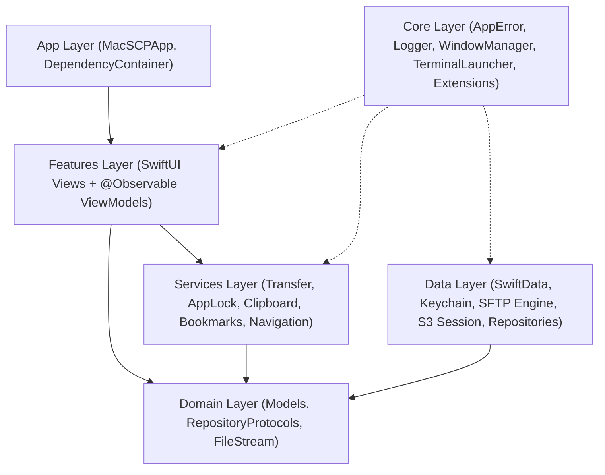

# SPEC-00: Kiến trúc Tổng thể MacSCP

## 1. Tổng quan
**MacSCP** là ứng dụng macOS native (yêu cầu **macOS 15.0+**, SwiftUI, Swift Concurrency) hỗ trợ quản lý tập tin đa giao thức: **SFTP**, **Amazon S3 / S3-Compatible**, và **Local File System** trong giao diện **Dual-Pane Commander** (phong cách Transmit 5), đi kèm trình soạn thảo văn bản tích hợp, Quick Look, tích hợp macOS Terminal và bảo mật sinh trắc học.

---

## 2. Phân tầng Kiến trúc (Clean Architecture + MVVM)

| Tầng | Thư mục | Trách nhiệm |
| :--- | :--- | :--- |
| **App** | `MacSCP/App/` | Entry point (`MacSCPApp`), khởi tạo scenes, Sparkle updater, `DependencyContainer`. |
| **Features** | `MacSCP/Features/` | Giao diện SwiftUI & ViewModels (`@MainActor @Observable`): `Commander`, `Connections`, `Browser`, `Editor`, `FileInfo`, `AppLock`, `Settings`. |
| **Services** | `MacSCP/Services/` | Logic nghiệp vụ dùng chung: `BatchTransferCoordinator`, `RemoteStreamTransferEngine`, `AppLockManager`, `BiometricAuthService`, `ClipboardService`, `LocalBookmarkService`, `FileTypeService`, `NavigationService`, `TransferSettings`. |
| **Domain** | `MacSCP/Domain/` | Domain Models thuần (`Connection`, `Folder`, `RemoteFile`, `SSHKeyItem`, `TransferProgress`, `BatchTransferProgress`, `ClipboardItem`), Repository Protocols và `FileStreamReader`. |
| **Data** | `MacSCP/Data/` | Triển khai lưu trữ & giao thức mạng: `SwiftData` (`DataStore`, Entities, Mappers), `Keychain` (`KeychainService`, `SSHKeyStorageService`), `SFTP` (`SFTPSession`, `Engine/*`), `S3` (`S3Session`), `Repositories/*`. |
| **Core** | `MacSCP/Core/` | Tiện ích lõi: `AppError`, `ViewState`, `Logger`, `Constants`, `WindowManager`, `TerminalLauncher`, Extensions. |
| **Shared** | `MacSCP/Shared/` | SwiftUI reusable components: `BadgeView`, `EmptyStateView`, `ErrorView`, `LoadingView`, `NameInputSheet`. |

---

## 3. Multi-Window Scene Architecture

Ứng dụng định nghĩa 6 SwiftUI Scenes trong `MacSCPApp.swift` (tất cả đều gắn `.appLockOverlay()`):

| Scene | Window ID | Mục đích |
| :--- | :--- | :--- |
| Main `WindowGroup` | Default | `CommanderWorkspaceView` — không gian làm việc Dual-Pane chính. |
| File Browser `WindowGroup` | `WindowID.fileBrowser` | `FileBrowserWindow` — cửa sổ duyệt file độc lập cho từng session. |
| File Editor `WindowGroup` | `WindowID.fileEditor` | `FileEditorWindow` — cửa sổ soạn thảo text/code trực tiếp trên remote. |
| Integrated Terminal `WindowGroup` | `WindowID.terminal` | `TerminalWindow` — cửa sổ SSH Terminal tích hợp (`SwiftTerm` + `swift-nio-ssh`). |
| File Info `WindowGroup` | `WindowID.fileInfo` | `FileInfoWindow` — hộp thoại thông tin chi tiết file/folder (content-sized). |
| `Settings` | `Cmd+,` | `SettingsView` — cài đặt ứng dụng (Transfers, SSH Keys, Known Hosts, Security). |

Quản lý trạng thái giữa các cửa sổ được điều phối qua `WindowManager` (`MacSCP/Core/Utilities/WindowManager.swift`).

---

## 4. Lưu trữ Dữ liệu (Persistence Strategy)

| Loại dữ liệu | Cơ chế lưu trữ | Thành phần quản lý |
| :--- | :--- | :--- |
| Connection profiles & Folders | **SwiftData** (`ConnectionEntity`, `FolderEntity`) | `DataStore`, `ConnectionRepository`, `FolderRepository` |
| Passwords & AWS Secret Access Keys | **macOS Keychain** (`kSecClassGenericPassword`) | `KeychainService` |
| SSH Private Keys | **macOS Keychain** (`com.macSCP.sshKeys`) | `SSHKeyStorageService` |
| SSH Key Metadata, Known Hosts, AppLock prefs, Transfer settings, Local Bookmark | **UserDefaults** | `SSHKeyStorageService`, `KnownHostsManager`, `AppLockManager`, `TransferSettings`, `LocalBookmarkService` |

---

## 5. Thư viện & Dependencies chính (SPM)

- **`swift-nio-ssh` & `SwiftNIO`**: Triển khai SSHv2 (SFTP pipelined + Interactive PTY Shell) bất đồng bộ hiệu năng cao.
- **`SwiftTerm`**: Terminal emulator (VT100/Xterm) tích hợp trực tiếp trong ứng dụng cho phiên SSH tương tác.
- **`aws-sdk-swift`**: Kết nối Amazon S3 và các dịch vụ S3-compatible (MinIO, DigitalOcean Spaces, Cloudflare R2, v.v.).
- **`Sparkle`**: Cơ chế kiểm tra và cập nhật phiên bản tự động (`SPUStandardUpdaterController`, `appcast.xml`).

---

## 6. Nguyên tắc Thiết kế & Invariants
1. **100% Local & Private:** Không gửi telemetry ra máy chủ ngoài (`AnalyticsService` chỉ ghi local debug log).
2. **Sandbox-Safe:** Ứng dụng chạy trong macOS App Sandbox; truy cập local filesystem phải qua `LocalBookmarkService` (Security-Scoped Bookmarks) và SSH key dùng Keychain-backed `SSHKeyStorageService` (không phụ thuộc đường dẫn `~/.ssh/` legacy).
3. **Protocol Abstraction:** Tầng Browser và Transfer tương tác với SFTP, S3 và Local thông qua `FileRepositoryProtocol` (hỗ trợ cả file transfer và `FileStreamReader`/`writeStream`).
4. **Concurrency Safety:** Toàn bộ ViewModel chạy trên `@MainActor` với `@Observable`; các session mạng (`SFTPSession`, `S3Session`) tách biệt xử lý I/O nền bằng `actor` / `async-await`.

---

## 7. Known Gaps & Technical Debt
- **P2 — CI chưa chạy unit tests trên pull request.** Workflow release chạy theo tag hoặc thủ công. Xem [báo cáo nợ kỹ thuật](../technical-debt.md#các-khoản-nợ-mở-ngày-2026-11-27).
- ~~`DataStore.swift:38` đang dùng `fatalError` khi khởi tạo `ModelContainer` thất bại; `DataStore.preview` chưa dùng `isStoredInMemoryOnly: true`~~ (Đã xử lý — 2026-11-26: bổ sung in-memory fallback + cảnh báo người dùng tại `CommanderWorkspaceView` và `DataStore(inMemoryOnly: true)` cho preview).
- ~~Nhiều ViewModel/Service còn gọi trực tiếp `.shared` thay vì nhận qua `DependencyContainer`~~ (Đã xử lý — 2026-11-26: mở rộng `DependencyContainer` và inject vào `FileBrowserViewModel`, `CommanderViewModel`, `SettingsView`).
